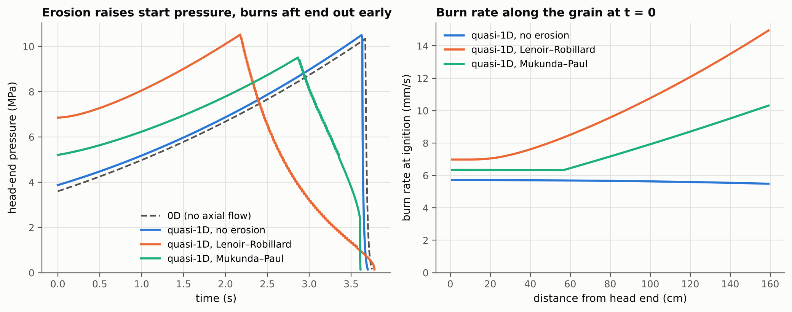
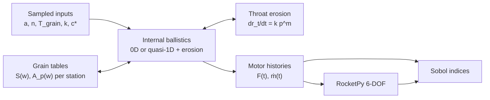
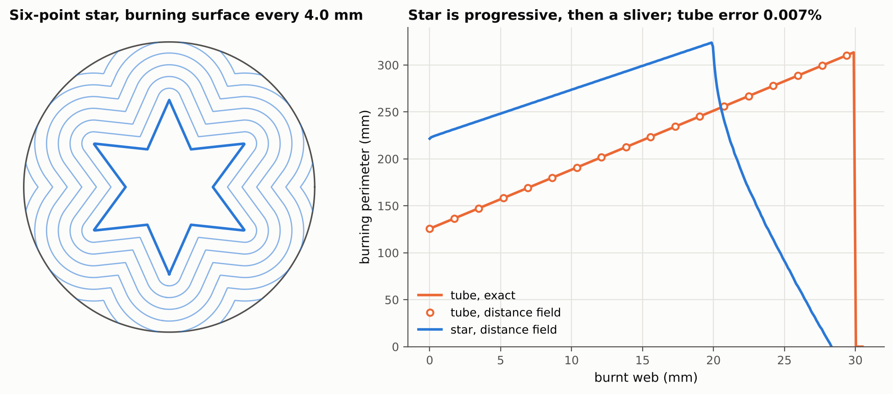
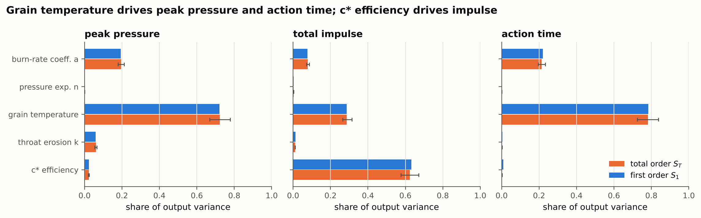

# srm-motor-to-flight

**Which uncertainties in a solid rocket motor actually move the flight?**

Trajectory tools such as [RocketPy](https://github.com/RocketPy-Team/RocketPy) treat the motor as a
fixed thrust curve with constant exhaust velocity. Real motors scatter. Propellant batches burn at
different rates, a cold grain burns slower than a hot one, and the nozzle throat erodes during the
burn. This project replaces the fixed curve with a physical motor model (grain burnback, internal
ballistics, erosive burning and throat erosion) and uses variance-based sensitivity analysis to
rank the inputs that drive motor and flight performance.



*A slender tube grain (L/D = 32) under three internal-ballistics models. Cross-flow erosion
almost doubles the start pressure and burns the aft end out 1.4 s early, a pressure history a
lumped (0D) model cannot produce.*

---

## How it works



| Stage | Method | Source |
| --- | --- | --- |
| Burnback | Signed-distance field of the port, level sets by marching squares | Willcox et al. 2007; Ren et al. 2021 |
| Burn rate | Saint Robert's law with temperature sensitivity σ_p | Davenas 1993 |
| Erosive burning | Lenoir–Robillard (implicit, D_h form) or Mukunda–Paul | Lenoir & Robillard 1957; Mukunda & Paul 1997 |
| Ballistics | 0D chamber ODE, or quasi-steady quasi-1D port flow with mass injection | Willcox et al. 2007 |
| Nozzle | Ideal Cf with throat recession k pᵐ | Sutton & Biblarz; Acharya & Kuo 2007 |
| Sensitivity | Saltelli sampling, Saltelli/Jansen estimators, bootstrap CIs | Saltelli 2010 |

**The modelling choice that keeps it fast.** Erosive burning makes the burn rate non-uniform, which
normally requires a level-set PDE. In a quasi-1D motor the rate varies only along the axis, so each
axial station still burns uniformly. Its burning surface is simply a level set of a distance field
computed once. A full burn costs a few seconds instead of a 3D surface-evolution solve. Equations
and assumptions are in [`docs/THEORY.md`](docs/THEORY.md).

## Results

**Burnback.** The distance-field method reproduces a tube grain's exact perimeter to 7 × 10⁻⁵ and
handles arbitrary port shapes.



**Sensitivity.** In a 7,168-run Sobol study of a star-grain motor, grain temperature over a
−40 to +60 °C envelope explains 72 % of peak-pressure variance and 78 % of action-time variance.
Batch scatter in burn rate explains most of the rest. Total impulse instead tracks c* efficiency
(62 %), with temperature second (29 %) through the higher thrust coefficient of a hotter,
higher-pressure burn. First- and
total-order indices agree to within 0.01, so the inputs act almost additively. The input ranges
are illustrative; replacing them with literature-backed distributions is part of the validation
milestone.



## Verification

Every solver is checked against a closed form, a conservation law or an analytic benchmark, and
each check runs in CI. Full table: [`docs/VERIFICATION.md`](docs/VERIFICATION.md).

| Check | Result |
| --- | --- |
| Tube burnback vs exact perimeter | 7.2 × 10⁻⁵ max rel. error |
| 0D burn time vs closed-form progressive tube | 0.34 % |
| Mass closure, 0D and quasi-1D | < 0.04 % |
| Quasi-1D reduces to 0D at low L/D | 0.11 % in total impulse |
| Sobol estimator vs analytic Ishigami indices | 9 × 10⁻⁴ max abs. error |

Validation against measured NAWC tactical-motor firings is the next milestone
([`validation/`](validation/README.md)).

## Quick start

```bash
git clone https://github.com/adamcw169/srm-motor-to-flight.git
cd srm-motor-to-flight
pip install -e ".[dev]"        # add ".[flight]" for RocketPy coupling
pytest                          # verification suite
python examples/02_erosive_1d.py
```

```python
from srmflight import Propellant, Nozzle, LenoirRobillard
from srmflight.geometry import AxialGrain, CircularPort
from srmflight.ballistics import QuasiOneDMotor

prop = Propellant(density=1750, a_ref=0.007, n=0.35, c_star=1500, gamma=1.2)
grain = AxialGrain.uniform(CircularPort(0.10, 0.05), length=1.6, n_stations=100)
erosion = LenoirRobillard.from_properties(2000, 8e-5, 0.5, 1750, 1250, 3000, 1000, 294.15)

result = QuasiOneDMotor(grain, prop, Nozzle(0.036, 0.075), erosive=erosion).run()
print(result.summary())   # peak pressure, total impulse, action time, delivered Isp
```

## Repository layout

```
src/srmflight/
├── geometry/        sections (tube, distance-field), grains, axial stations
├── ballistics/      zerod.py (chamber ODE), quasi1d.py (port flow + erosion)
├── propellant.py    burn-rate law, temperature sensitivity, c*
├── erosive.py       Lenoir–Robillard, Mukunda–Paul
├── nozzle.py        thrust coefficient, throat erosion
├── flight.py        RocketPy adapter, constant-v_e error metric
└── uq/sobol.py      Saltelli sampling and estimators
tests/               verification suite (pytest)
examples/            scripts that produce every figure in this README
docs/                theory, verification, references
validation/          test-firing cases and published inputs
```

## Scope and limitations

- Ignition, flame spreading and dynamic (Zel'dovich–Novozhilov) burning are not modelled. Runs start
  at the equilibrium pressure.
- The quasi-1D solver is quasi-steady and treats segment end faces as inhibited.
- Throat erosion is an empirical power law. Its coefficient is a calibration and uncertainty input.
- Propellant values in the examples are generic textbook-class numbers, not a specific formulation.
- The RocketPy adapter targets the RocketPy 1.x `GenericMotor`. Flight-level Sobol results are on
  the roadmap.

## Roadmap

- [ ] Validate against NAWC motors 13 and 6 (Blomshield 2000; Willcox et al. 2007)
- [ ] Calibrate throat erosion on Acharya & Kuo (2007) firing data
- [ ] Flight-level Sobol indices (apogee, range, dispersion) through RocketPy
- [ ] Burning end faces and star-to-tube transitions in the quasi-1D solver

## References

Key sources are listed in [`docs/REFERENCES.md`](docs/REFERENCES.md): Willcox et al. (2007, *JPP*),
Ren et al. (2021, *Chinese J. Aeronautics*), Lenoir & Robillard (1957), Mukunda & Paul (1997,
*Combustion and Flame*), Acharya & Kuo (2007, *JPP*), Ceotto et al. (2021, *J. Aerospace Eng.*) and
Saltelli et al. (2010).

---

Adam Williams · MEng Aeronautical & Astronautical Engineering, University of Southampton ·
MIT licence
