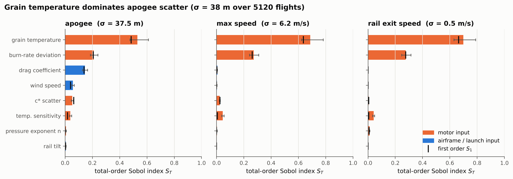
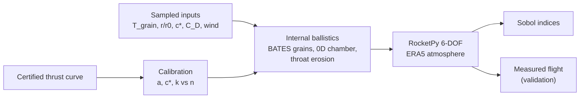
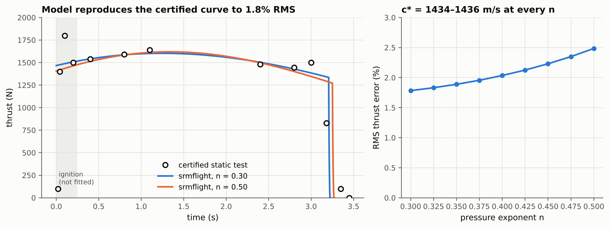
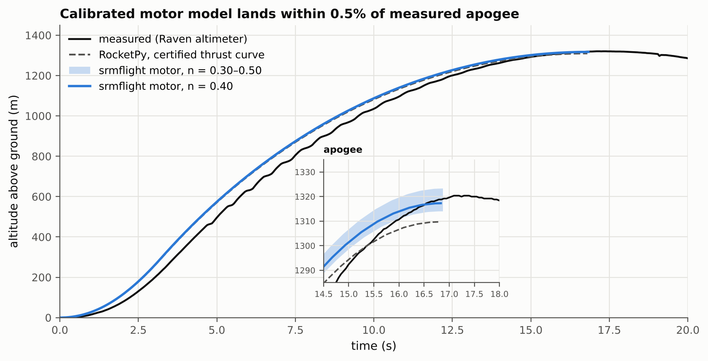
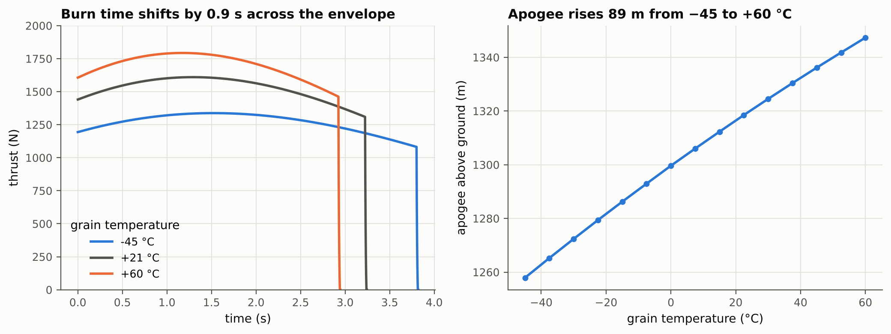

# srm-motor-to-flight

**Which uncertainties in a solid rocket motor actually move the flight?**

Trajectory tools treat the motor as a fixed thrust curve. Real motors scatter: a cold grain burns
slower than a hot one, propellant batches differ, and nozzle throats erode. This project replaces
the fixed curve with a physical motor model, calibrates it to a certified static test, validates
the coupled 6-DOF flight against a measured launch, and ranks every input by its share of flight
dispersion.



*5,120 motor + flight simulations of the Notre Dame Rocket Team's 2020 launch. Motor inputs carry
about 80 % of apogee variance; grain temperature alone carries half.*

---

## How it works



| Stage | Method | Source |
| --- | --- | --- |
| Burnback | Signed-distance field of the port, level sets by marching squares | Willcox et al. 2007; Ren et al. 2021 |
| Burn rate | Saint Robert's law, temperature sensitivity σ_p = (1 − n) π_K | Davenas 1993 |
| Erosive burning | Lenoir–Robillard (implicit, D_h form) or Mukunda–Paul | Lenoir & Robillard 1957; Mukunda & Paul 1997 |
| Ballistics | 0D chamber ODE, or quasi-steady quasi-1D port flow | Willcox et al. 2007 |
| Nozzle | Ideal C_F, throat recession k·p | Sutton & Biblarz; Acharya & Kuo 2007 |
| Calibration | Bounded least squares on a certified thrust curve | this work |
| Flight | RocketPy `SolidMotor` + 6-DOF, ERA5 reanalysis | Ceotto et al. 2021 |
| Sensitivity | Saltelli sampling, Saltelli/Jansen estimators, bootstrap CIs | Saltelli et al. 2010 |

Equations and assumptions: [`docs/THEORY.md`](docs/THEORY.md).

## Results

**1. Calibration.** The five-grain BATES model of the Cesaroni L1395 reproduces its certified
thrust curve to 1.8 % RMS and its total impulse to 0.3 %. c* is identified to ±0.1 %. The pressure
exponent and throat erosion trade off against each other, so the model is calibrated as a family
across the literature range of n.



**2. Flight validation.** Flown in RocketPy with the measured-day atmosphere, the calibrated motor
lands within 0.5 % of the Raven altimeter's apogee (1320 m). The certified-curve run gives −0.81 %,
matching RocketPy's published −0.75 %. Details: [`validation/README.md`](validation/README.md).



**3. Sensitivity.** Over 5,120 flights, apogee varies by σ = 37.5 m.

- Grain temperature across a −45 to +60 °C envelope: S_T = 0.53.
- Burn-rate deviation: 0.21.
- Drag coefficient: 0.15. Wind: 0.06.
- The pressure exponent, the one parameter the certified curve cannot pin down, contributes under 1 %.
  The calibration ambiguity therefore does not affect the conclusions.



## Verification

Every solver is checked against a closed form, a conservation law or an analytic benchmark, and
all 41 tests run in CI. Full table: [`docs/VERIFICATION.md`](docs/VERIFICATION.md).

| Check | Result |
| --- | --- |
| Distance-field burnback vs exact tube perimeter | 7.2 × 10⁻⁵ max rel. error |
| 0D burn time vs closed-form progressive tube | 0.34 % |
| Mass closure, 0D and quasi-1D | < 0.04 % |
| Calibration recovers a known motor | 0.28 % |
| Sobol estimator vs analytic Ishigami indices | 9 × 10⁻⁴ max abs. error |

The quasi-1D solver with erosive burning, verified here but not needed for the short NDRT motor, is
demonstrated in `examples/02_erosive_1d.py`.

## Quick start

```bash
git clone https://github.com/adamcw169/srm-motor-to-flight.git
cd srm-motor-to-flight
pip install -e ".[dev,flight]"
python validation/ndrt/fetch_data.py      # NDRT data from the RocketPy repository
pytest                                    # verification + flight validation
python examples/04_ndrt_flight_validation.py
```

```python
from srmflight.cases import ndrt2020 as nd

cal = nd.Calibration.load("validation/ndrt/calibration.json")
motor = nd.l1395(**cal.at(0.40), T_grain=273.15 - 20)   # a cold grain
print(motor.summary())                                    # peak pressure, impulse, burn time
flight = nd.fly(nd.motor_from_result(motor), nd.environment("validation/ndrt/data"))
print(flight.apogee - nd.ELEVATION)
```

## Repository layout

```
src/srmflight/
├── geometry/        port sections (tube, distance field), BATES and axial grains
├── ballistics/      zerod.py (chamber ODE), quasi1d.py (port flow + erosive burning)
├── propellant.py    burn-rate law, temperature sensitivity, c*
├── erosive.py       Lenoir–Robillard, Mukunda–Paul
├── nozzle.py        thrust coefficient, throat erosion
├── calibration.py   .eng reader, thrust-curve fitting
├── flight.py        RocketPy helpers, constant-v_e error metric
├── cases/ndrt2020.py  L1395 motor, airframe, ERA5 atmosphere, measured flight
└── uq/sobol.py      Saltelli sampling and estimators
tests/               41 tests: verification + flight validation
examples/            scripts that produce every figure and result file
validation/          NDRT data fetcher, calibration and results (JSON)
docs/                theory, verification, references
```

## Scope and limitations

- Ignition and tail-off transients are not modelled. The fit excludes the first 0.25 s.
- Grain temperature changes the burn rate only, not c*.
- The airframe uses RocketPy's published NDRT configuration unchanged, including its aerodynamic
  model.
- The NDRT motor's propellant is proprietary. Its burn-rate law and c* are calibrated, not predicted.
- The temperature envelope is a qualification-style stress range, not a launch-day spread.

## References

[`docs/REFERENCES.md`](docs/REFERENCES.md): Davenas (1993), Willcox et al. (2007, *JPP*),
Ren et al. (2021, *Chinese J. Aeronautics*), Acharya & Kuo (2007, *JPP*), Ceotto et al. (2021,
*J. Aerospace Eng.*), Saltelli et al. (2010). Flight data courtesy of the Notre Dame Rocket Team
via RocketPy.

---

Adam Williams · MEng Aeronautical & Astronautical Engineering, University of Southampton ·
MIT licence
