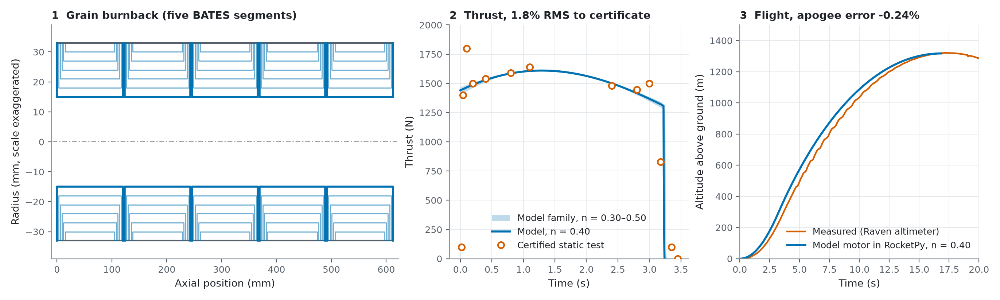
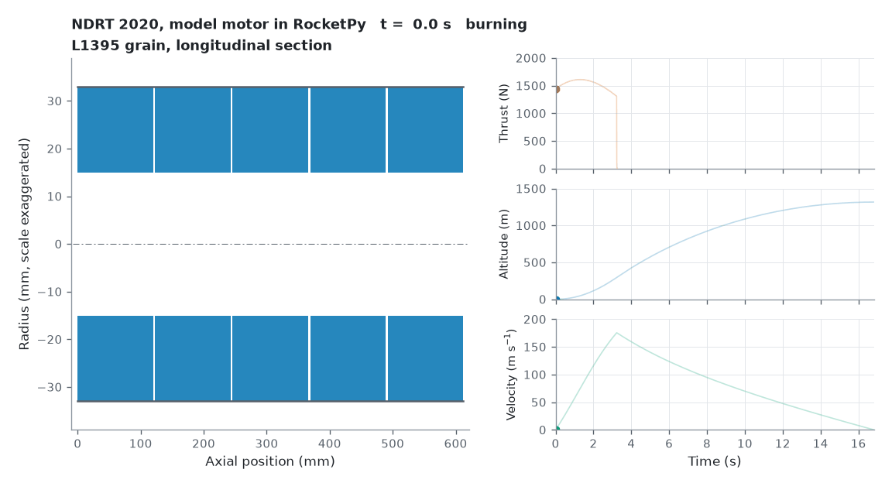
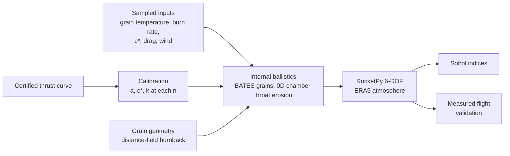
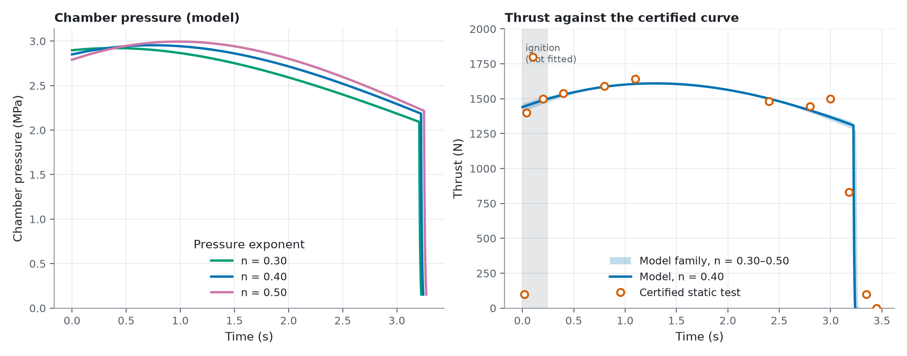
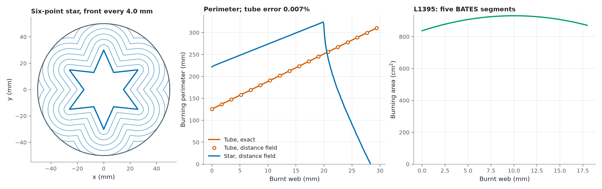
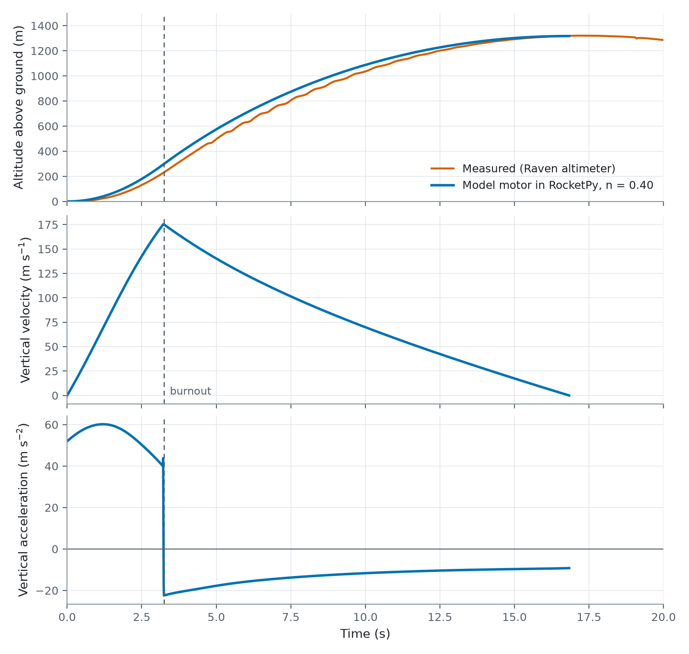
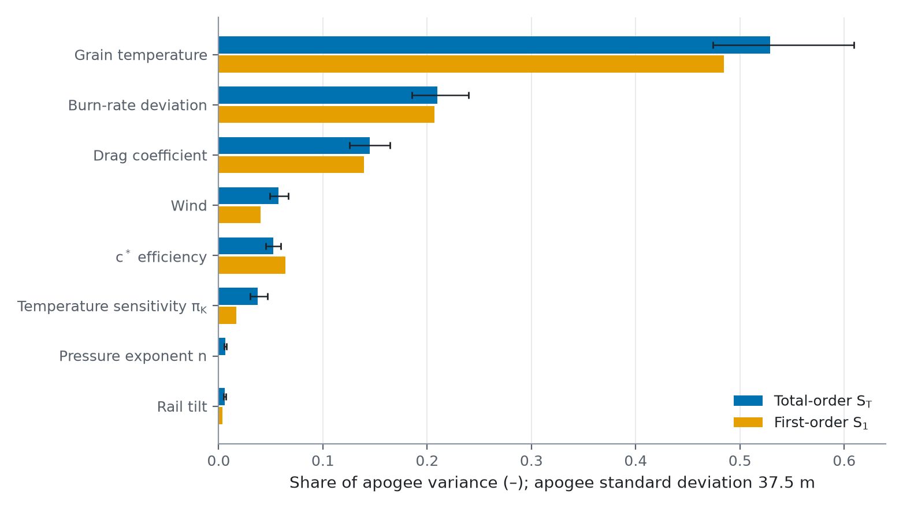
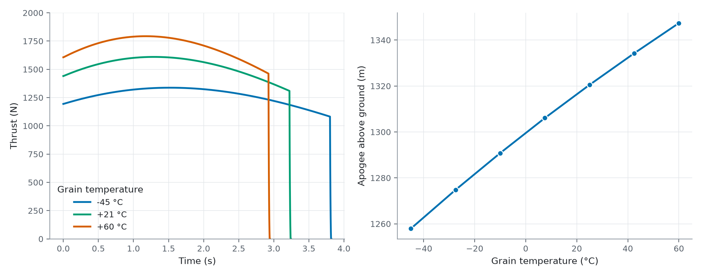

# SRM Motor to Flight

**A solid rocket motor internal-ballistics model, calibrated to a certified static test, coupled to a six-degree-of-freedom flight simulation and validated against a measured launch.**


[](https://github.com/adamcw169/SRM-motor-to-flight/actions/workflows/tests.yml)

<picture>
  <source media="(prefers-color-scheme: dark)" srcset="docs/assets/hero_motor_to_flight-dark.png">
  
</picture>

*From grain to apogee for the Notre Dame Rocket Team's 2020 flight. 1: burning surface of the five BATES segments at even web steps. 2: model thrust against the Cesaroni L1395 certified curve. 3: the model motor flown in RocketPy against the Raven altimeter record.*

<picture>
  <source media="(prefers-color-scheme: dark)" srcset="docs/assets/flight-dark.gif">
  
</picture>

*The same run against time: the grain regresses over the 3.2 s burn while thrust, altitude and vertical velocity build to apogee at 16.8 s.*

## Key results

- **Calibration.** A five-segment BATES model of the Cesaroni L1395 reproduces its certified thrust curve to 1.8% RMS and its total impulse to 0.3%. The characteristic velocity $c^*$ is identified to ±0.1%.
- **Flight validation.** Flown in RocketPy with the launch-day ERA5 atmosphere, the calibrated motor reaches 1317 m against a measured apogee of 1320 m (−0.24% at $n = 0.40$; within 0.5% across the calibrated family).
- **Sensitivity.** Over 5,120 coupled motor and flight simulations, apogee varies with a standard deviation of 37.5 m. Motor inputs carry about 80% of that variance; grain temperature alone has a total-order index of 0.53.
- **Calibration ambiguity is harmless.** The pressure exponent, the one parameter the certified curve cannot pin down, contributes under 1% of apogee variance.
- **Verification.** Every solver is checked against a closed form, a conservation law or an analytic benchmark; 41 tests run in CI.

### Key performance numbers

Model motor at $n = 0.40$, 21 °C grain, flown on the NDRT 2020 airframe. Generated by `scripts/make_figures.py` into [`docs/assets/key_numbers.json`](docs/assets/key_numbers.json).

| Quantity | Value |
|---|---|
| Peak chamber pressure | 2.95 MPa |
| Peak thrust | 1610 N |
| Total impulse | 4919 N s |
| Action time (10% of peak thrust) | 3.23 s |
| Effective exhaust velocity | 1987 m s⁻¹ |
| Throat diameter growth over the burn | 2.3 mm |
| Apogee above ground | 1317 m (measured 1320 m) |
| Time to apogee | 16.8 s |
| Maximum speed | 176 m s⁻¹ (Mach 0.53) |
| Maximum acceleration | 60 m s⁻² |

## Background and motivation

Trajectory tools usually treat the motor as a fixed thrust curve. Real motors scatter: a cold grain burns more slowly than a hot one, propellant batches differ, and nozzle throats erode. This project replaces the fixed curve with a physical motor model so that those uncertainties can be propagated through to the flight, and asks which of them matter.

The test case is the Notre Dame Rocket Team (NDRT) launch of 23 February 2020, RocketPy's published validation case [2]. Its motor, a Cesaroni L1395, has a certified static-test thrust curve but proprietary propellant data, so the burn-rate law and $c^*$ are calibrated, not predicted.

## Method



### Governing equations

**Burnback.** For uniform regression, the burning surface at burnt web $w$ is the $w$-level set of the signed distance $\phi$ to the initial port boundary [6, 10]. A segment of length $L$ with $n_e$ burning end faces has burning area

$$A_b(w) = S(w)(L - n_e w) + n_e\left(A_{case} - A_p(w)\right)$$

where $S(w)$ is the burning perimeter and $A_p(w)$ the port area.

**Burn rate.** Saint Robert's law with exponential temperature sensitivity [3]:

$$r = a_{ref}\exp\left[\sigma_p (T_i - T_{ref})\right]\left(\frac{p}{p_{ref}}\right)^n, \qquad \sigma_p = (1 - n)\pi_K$$

**Chamber.** A zero-dimensional isothermal chamber at the delivered $c^*$, integrated from an equilibrium start to burnout:

$$\frac{V}{R T_0}\frac{\mathrm{d}p}{\mathrm{d}t} = A_b r\left(\rho_p - \frac{p}{R T_0}\right) - \frac{p A_t}{c^*}$$

**Nozzle.** Ideal thrust coefficient with an efficiency factor [9], and throat recession linear in pressure [1]:

$$F = \eta_F C_F p A_t, \qquad C_F = \sqrt{\frac{2\gamma^2}{\gamma - 1}\left(\frac{2}{\gamma + 1}\right)^{\frac{\gamma + 1}{\gamma - 1}}\left[1 - \left(\frac{p_e}{p}\right)^{\frac{\gamma - 1}{\gamma}}\right]} + \frac{A_e}{A_t}\frac{p_e - p_a}{p}$$

$$\frac{\mathrm{d}r_t}{\mathrm{d}t} = k\frac{p}{p_{ref}}$$

**Calibration.** $(a_{ref}, c^*, k)$ are found by bounded least squares on the quasi-steady part of the certified trace plus a total-impulse constraint, at each pressure exponent $n$ from 0.30 to 0.50.

**Flight.** The thrust history passes to a RocketPy `SolidMotor` with the real grain geometry and is flown in six degrees of freedom through the ERA5 reanalysis atmosphere for the launch [2, 4].

**Sensitivity.** Saltelli sampling on scrambled Sobol sequences, with the Saltelli (2010) first-order and Jansen (1999) total-order estimators and bootstrap confidence intervals [5, 8].

The quasi-1D port-flow solver and the erosive-burning models (Lenoir–Robillard, Mukunda–Paul) are documented in [`docs/THEORY.md`](docs/THEORY.md). They are verified but not needed for the short NDRT motor.

### Assumptions

- Ignition and tail-off transients are not modelled; the fit excludes the first 0.25 s.
- Combustion-gas ratio of specific heats 1.20 and thrust-coefficient efficiency 0.95 are assumed; $c^*$ absorbs the remainder.
- Grain temperature changes the burn rate only, not $c^*$.
- The airframe is RocketPy's published NDRT configuration, unchanged, including its aerodynamic model.

## Validation and verification

**Validation against measured data** (details in [`validation/README.md`](validation/README.md)):

| Comparison | Reference | Result |
|---|---|---|
| Thrust curve | Cesaroni L1395 certified static test | 1.8–2.5% RMS and +0.3 to +0.9% total impulse across $n$ = 0.30–0.50 |
| Throat erosion rate | Acharya & Kuo [1], Fig. 4a: 0.25–1.3 mm s⁻¹ at 7 MPa | Fitted 0.67–1.26 mm s⁻¹, inside the band |
| Apogee, certified curve in RocketPy | Raven altimeter, 1320.4 m | 1309.7 m (−0.81%); RocketPy publishes −0.75% [2] |
| Apogee, model motor, $n$ = 0.30 | Raven altimeter | 1314.0 m (−0.48%) |
| Apogee, model motor, $n$ = 0.40 | Raven altimeter | 1317.3 m (−0.23%) |
| Apogee, model motor, $n$ = 0.50 | Raven altimeter | 1323.3 m (+0.22%) |

The model's slightly closer match than the certified curve is within its own calibration uncertainty, so the two should be treated as equivalent. The simulated ascent runs ahead of the altimeter trace mid-flight and converges at apogee, as the flight-profile figure below shows.

**Verification against exact results** (full table in [`docs/VERIFICATION.md`](docs/VERIFICATION.md)):

| Check | Result |
|---|---|
| Distance-field burnback against exact tube perimeter | 7.2 × 10⁻⁵ maximum relative error |
| 0D burn time against closed-form progressive tube | 0.34% |
| Mass closure, 0D and quasi-1D | below 0.04% |
| Calibration recovers a known motor | 0.28% |
| Sobol estimator against analytic Ishigami indices | 9 × 10⁻⁴ maximum absolute error |

## Results gallery

<picture>
  <source media="(prefers-color-scheme: dark)" srcset="docs/assets/pressure_thrust-dark.png">
  
</picture>

*Chamber pressure for three pressure exponents, and thrust against the certified curve. The calibrated family is almost indistinguishable in thrust.*

<picture>
  <source media="(prefers-color-scheme: dark)" srcset="docs/assets/grain_burnback-dark.png">
  
</picture>

*Burnback by signed-distance field: a six-point star port, its burning perimeter against an exact tube solution, and the burning area of the L1395's five BATES segments.*

<picture>
  <source media="(prefers-color-scheme: dark)" srcset="docs/assets/flight_profile-dark.png">
  
</picture>

*Flight profile to apogee: altitude against the Raven altimeter, vertical velocity and vertical acceleration.*

<picture>
  <source media="(prefers-color-scheme: dark)" srcset="docs/assets/sobol_apogee-dark.png">
  
</picture>

*Sobol indices for apogee over 5,120 motor and flight simulations, with bootstrap intervals on the total-order indices.*

<picture>
  <source media="(prefers-color-scheme: dark)" srcset="docs/assets/temperature_sweep-dark.png">
  
</picture>

*Grain temperature from −45 to +60 °C: action time shortens from 3.81 to 2.94 s and apogee rises by 89 m.*

### Sampled inputs for the sensitivity study

| Input | Distribution | Source | Total-order index |
|---|---|---|---|
| Grain temperature | U(−45, +60) °C | Davenas [3], ch. 1 §2.6 | 0.53 |
| Burn-rate deviation | U(0.95, 1.05) | Davenas [3], ch. 4 §3.1.2 | 0.21 |
| Drag coefficient | N(1, 0.033) × $C_D$ | RocketPy NDRT case [7] | 0.15 |
| Wind speed | N(1, 0.30) × ERA5 | RocketPy NDRT case [7] | 0.06 |
| $c^*$ scatter | N(1, 0.0037) | Davenas [3], ch. 3 | 0.05 |
| Temperature sensitivity $\pi_K$ | U(0.15, 0.35) % per °C | Davenas [3], ch. 1 §2.6 | 0.04 |
| Pressure exponent $n$ | U(0.30, 0.50), calibrated family | Davenas [3], ch. 2 Table 3 | 0.006 |
| Rail tilt | half-normal, σ = 1° | RocketPy NDRT case [7] | 0.006 |

## Quick start

```bash
git clone https://github.com/adamcw169/SRM-motor-to-flight.git
cd SRM-motor-to-flight
pip install -r requirements.txt
python validation/ndrt/fetch_data.py
```

The last command downloads the NDRT thrust curve, altimeter record and ERA5 file from the RocketPy repository at a pinned commit; they are not redistributed here. `pip install -e ".[dev,flight]"` is equivalent to the requirements file.

Reproduce every figure, the animation and the key-numbers table (about 90 seconds):

```bash
python scripts/make_figures.py
```

Run the tests and the underlying studies:

```bash
pytest                                        # 41 tests: verification and flight validation
python examples/03_ndrt_calibration.py        # calibration
python examples/04_ndrt_flight_validation.py  # flight validation
python examples/05_ndrt_flight_sobol.py       # 5,120 flights, about 20 minutes
```

```python
from srmflight.cases import ndrt2020 as nd

cal = nd.Calibration.load("validation/ndrt/calibration.json")
motor = nd.l1395(**cal.at(0.40), T_grain=273.15 - 20)   # a cold grain
print(motor.summary())                                    # peak pressure, impulse, burn time
flight = nd.fly(nd.motor_from_result(motor), nd.environment("validation/ndrt/data"))
print(flight.apogee - nd.ELEVATION)
```

## Repository structure

```
src/srmflight/
├── geometry/          port sections (tube, distance field), BATES and axial grains
├── ballistics/        zerod.py (chamber ODE), quasi1d.py (port flow and erosive burning)
├── propellant.py      burn-rate law, temperature sensitivity, c*
├── erosive.py         Lenoir–Robillard, Mukunda–Paul
├── nozzle.py          thrust coefficient, throat erosion
├── calibration.py     .eng reader, thrust-curve fitting
├── flight.py          RocketPy helpers, constant exhaust-velocity error metric
├── cases/ndrt2020.py  L1395 motor, airframe, ERA5 atmosphere, measured flight
└── uq/sobol.py        Saltelli sampling and estimators
scripts/               make_figures.py and figures.mplstyle
examples/              calibration, validation, Sobol and verification studies (write the result JSON)
validation/            NDRT data fetcher, calibration and results (JSON)
docs/                  theory, verification, references; assets/ holds the generated figures
tests/                 41 tests
```

## Limitations and future work

- **Transients.** Ignition and tail-off are not modelled, so the ignition spike in the certified curve is not reproduced.
- **Calibrated, not predicted.** The L1395 propellant is proprietary; its burn-rate law and $c^*$ come from the fit. A motor with published propellant data would allow a predictive test.
- **Temperature model.** Grain temperature changes the burn rate only, not $c^*$.
- **Temperature envelope.** The −45 to +60 °C range is a qualification-style stress range, not a launch-day spread, so the sensitivity ranking reflects that choice.
- **Airframe.** RocketPy's published NDRT configuration and aerodynamic model are used unchanged. RocketPy reports a −0.18 calibre static margin at ignition for it, where the team measured +2.9.
- **One flight.** Validation rests on a single launch and on apogee; more flights and measured chamber pressure would strengthen it.

## References

Full list with usage notes: [`docs/REFERENCES.md`](docs/REFERENCES.md).

1. Acharya, R. & Kuo, K. K. (2007). Effect of pressure and propellant composition on graphite rocket nozzle erosion rate. *Journal of Propulsion and Power* 23(6), 1242–1254.
2. Ceotto, G. H. et al. (2021). RocketPy: six degree-of-freedom rocket trajectory simulator. *Journal of Aerospace Engineering* 34(6).
3. Davenas, A. (ed.) (1993). *Solid Rocket Propulsion Technology*. Pergamon.
4. Hersbach, H. et al. (2020). The ERA5 global reanalysis. *Quarterly Journal of the Royal Meteorological Society* 146, 1999–2049.
5. Jansen, M. J. W. (1999). Analysis of variance designs for model output. *Computer Physics Communications* 117, 35–43.
6. Ren, P. et al. (2021). Solid rocket motor propellant grain burnback simulation based on fast minimum distance function calculation and improved marching tetrahedron method. *Chinese Journal of Aeronautics* 34(4), 208–224.
7. RocketPy Team. RocketPy v1.13.0 and its NDRT 2020 acceptance test. https://github.com/RocketPy-Team/RocketPy
8. Saltelli, A. et al. (2010). Variance based sensitivity analysis of model output. *Computer Physics Communications* 181, 259–270.
9. Sutton, G. P. & Biblarz, O. (2016). *Rocket Propulsion Elements*, 9th ed. Wiley.
10. Willcox, M. A. et al. (2007). Solid rocket motor internal ballistics simulation using three-dimensional grain burnback. *Journal of Propulsion and Power* 23(3), 575–584.

Flight data courtesy of the Notre Dame Rocket Team via RocketPy.

## Licence

MIT. See [LICENSE](LICENSE).

## Author

Adam Williams, MEng Aeronautical & Astronautical Engineering, University of Southampton.
